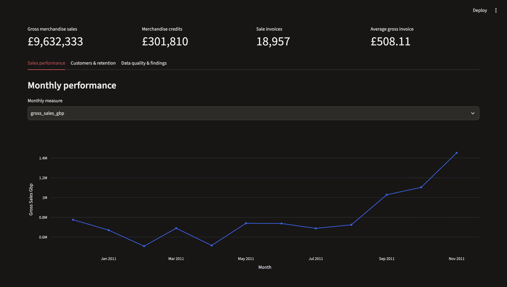
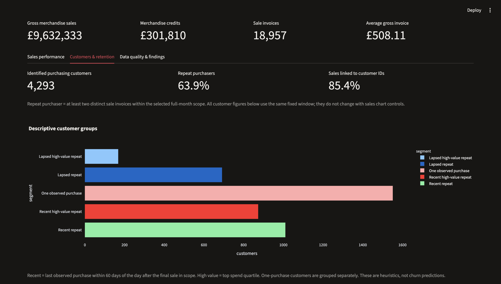
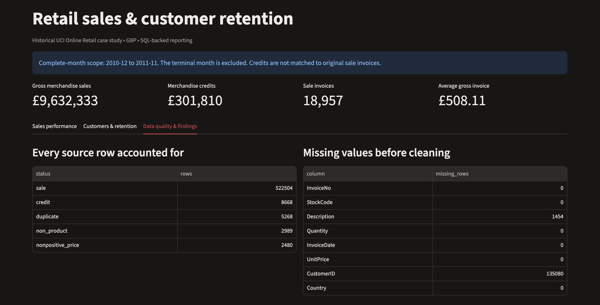

# Online Retail Sales & Customer Retention Analysis

**Turning 541,909 retail transaction records into sales insights, customer segments and a reproducible analytics dashboard.**

Built with **Python · pandas · SQLite · SQL · Streamlit · Plotly**

[Business findings](reports/findings.md) · [SQL queries](sql/) · [Methodology](docs/methodology.md) · [Validation results](reports/run_metadata.json)

## Project overview

This project examines a historical UK online gift retailer's sales and customer purchasing behaviour. It combines an auditable Python preparation pipeline, SQL analysis and an interactive dashboard to investigate product performance, merchandise credits and repeat purchasing.

The goal is to demonstrate the complete analytics workflow: define a business problem, inspect and prepare the data, calculate consistent metrics, communicate findings and document the limits of the analysis.

**Source:** UCI Online Retail, December 2010–December 2011.  
**Comparative analysis window:** December 2010–November 2011. The final partial month is excluded.

## Dashboard preview

### Sales performance
Sales KPIs and monthly trends across the complete-month analysis period.



### Customers and retention
Repeat purchasing, customer identification coverage and descriptive customer segments.



### Data quality and validation
Source-row classifications, missing values and automated validation results.



## Business questions

- How do sales and merchandise credit values change month by month?
- Which products and countries contribute the most gross sales?
- Which products warrant investigation because of high credit values relative to sales?
- How many identified customers purchase more than once?
- How does repeat purchasing develop across first-observed-purchase cohorts?

## Results at a glance

Results below use the documented full-month merchandise scope and cleaning rules.

| Metric | Result |
| --- | ---: |
| Gross merchandise sales | £9,632,333.24 |
| Merchandise credit value | £301,809.80 |
| Gross sales minus merchandise credits | £9,330,523.44 |
| Distinct sale invoices | 18,957 |
| Average gross sale invoice value | £508.11 |
| Identified purchasing customers | 4,293 |
| Identified customers with at least two sale invoices | 63.9% |
| Gross sales linked to an identified customer | 85.4% |

**These figures are descriptive results, not evidence of business improvements.** Net merchandise value excludes non-product transactions and is not profit or audited accounting revenue.

## Key findings and business implications

| Finding | Potential business use | Interpretation limit |
| --- | --- | --- |
| November 2011 had the highest monthly gross sales: £1.45 million. | Review purchasing and stock planning around high-demand periods. | One historical year cannot establish a reliable seasonal pattern. |
| REGENCY CAKESTAND 3 TIER, product 22423, led gross product sales at £168,162.42. | Prioritise investigation of stock availability and product concentration. | Sales value alone does not reveal margin or profitability. |
| 63.9% of identified purchasing customers placed at least two sale invoices within the analysis window. | Explore repeat-customer engagement and compare cohort behaviour. | This is a repeat-purchaser share, not a monthly retention rate. |
| Only 85.4% of gross sales could be linked to a customer ID. | Track customer-data coverage before generalising customer findings. | Identified customers may differ from unidentified purchasers. |

Product credit ratios and recency-based customer groups provide additional investigation starting points. Recommendations should be tested before claiming any effect on sales or retention.

## Interactive dashboard

The dashboard runs locally in a browser and contains three tabs:

| Tab | Contents |
| --- | --- |
| **Sales performance** | KPI cards, monthly sales and credits, leading products and countries, and products with high credit-to-sales value ratios |
| **Customers & retention** | Repeat-purchase metrics, descriptive customer groups and a monthly cohort retention heatmap |
| **Data quality & findings** | Source-row disposition, missing-value counts, validation checks, findings and limitations |

Controls let users change the monthly measure, leading-product count, UK inclusion in the country chart and minimum sales threshold for product investigation. Customer groups and retention retain the same fixed analysis window.

## Tools and workflow

| Tool | Role |
| --- | --- |
| Python and pandas | Read, normalise, classify and audit source records |
| openpyxl | Read the original Excel workbook |
| SQLite | Store prepared transactions and shared analysis views |
| SQL | Calculate reports using aggregations, joins, CTEs, LAG and NTILE |
| Streamlit and Plotly | Present interactive charts, tables and data-quality evidence |
| unittest | Check classification rules and SQL edge cases |
| Git | Track project source and documentation |

**Workflow:** original workbook → Python audit and classification → SQLite tables and views → SQL reports → dashboard and findings.

## Data preparation and analytical decisions

- **Invoice lines versus orders:** each source row is an invoice line. Order counts use distinct qualifying sale invoice numbers.
- **Exact repetitions:** 5,268 repeated rows are excluded after the first occurrence. This is a documented assumption; identical lines can sometimes be legitimate.
- **Missing customer IDs:** retained for eligible sales totals and excluded from customer-level analysis. No customer identities are invented.
- **Sales versus credits:** qualifying C-prefixed invoices with negative quantities are classified as credits. They are kept separate from positive sales.
- **Unexpected records:** non-C negative quantities, C-prefixed positive quantities and other inconsistent combinations are assigned for review when present.
- **Product scope:** a documented product-code pattern distinguishes merchandise from nonstandard service or adjustment codes. This is a heuristic, not a verified product catalogue.
- **Nonpositive prices:** excluded from merchandise sales metrics and retained in the audit.
- **Time coverage:** December 2011 contains only a partial month and is excluded from comparative reports.

Every source row receives one classification, and the transaction-level audit preserves the original row reference. Read the [methodology](docs/methodology.md) for exact precedence, formulas and exclusions.

## Customer retention approach

Customers are grouped by their **first observed purchase month** within the analysis window. For each subsequent observed month, retention is the proportion of that original cohort making a qualifying purchase.

- Month 0 is 100% by definition.
- An observed month with no purchases is 0%.
- Future, unobserved months remain blank.
- A first observed purchase is not necessarily the customer's first-ever purchase.

The dashboard also shows transparent RFM-style groups based on purchase recency, invoice frequency and gross spend. These are descriptive business rules, not a churn prediction model.

## Run the project

Use Python 3.11 or newer. Open a terminal in the repository root.

### 1. Create and activate an environment

**macOS / Linux**

```bash
python3 -m venv .venv
source .venv/bin/activate
```

**Windows PowerShell**

```powershell
py -m venv .venv
.venv\Scripts\Activate.ps1
```

If using an existing PyCharm project environment, activate that environment instead of creating another one.

### 2. Install dependencies

```bash
python -m pip install -r requirements.txt
```

### 3. Obtain the original data

Download the workbook from the [UCI Online Retail dataset page](https://archive.ics.uci.edu/dataset/352/online-retail), extract the ZIP and place **Online Retail.xlsx** inside `data/raw/`. Create those folders if they do not exist. Keep the original workbook unchanged.

### 4. Validate and rebuild the analysis

```bash
python -m unittest discover -s tests -v
python retail_pipeline.py
```

The pipeline rebuilds the audit export, SQLite database, report CSVs, findings and run metadata. To use a workbook stored elsewhere:

```bash
python retail_pipeline.py --input "/path/to/Online Retail.xlsx"
```

### 5. Launch the dashboard

```bash
python -m streamlit run dashboard.py
```

Open the local URL printed in the terminal. Leave the optional first-run email prompt blank if preferred. Stop the server with **Control+C**.

The supplied aggregate reports also allow the dashboard to run before rebuilding the pipeline. GitHub hosts the project files; uploading the repository does not itself publish a running Streamlit app.

## Validation and reproducibility

The full source workbook was processed successfully, with **10 pipeline validation checks** and **two regression test cases** passing.

Validation covers SQL-versus-Python sales and credit totals, invoice counts, monthly reconciliation, sale and credit classification, retention bounds and month-zero retention. The regression cases also cover missing customer IDs, duplicates, malformed rows, credit-only products and observed zero-retention months.

- [Run metadata](reports/run_metadata.json) records the source workbook's SHA-256 hash, row dispositions, analysis window and validation outcomes.
- [Validation notes](docs/VALIDATION.md) describe the checks performed.
- [Tested environment](docs/tested-environment.txt) records the package versions used for the supplied reports.
- `requirements.txt` declares dependency ranges rather than a fully locked environment.
- Paths are resolved relative to the project, avoiding hard-coded personal directories.

## Repository contents

| Path | Purpose |
| --- | --- |
| `inspect_data.py` | Initial dataset-loading and inspection script created during setup |
| `retail_pipeline.py` | Preparation, audit, SQLite loading, SQL execution and report generation |
| `dashboard.py` | Interactive dashboard |
| `sql/00_views.sql` | Shared sale and credit views |
| `sql/01_overview.sql`–`sql/06_cohorts.sql` | Six analytical reports |
| `reports/` | Generated summaries, findings and validation metadata |
| `docs/methodology.md` | Metric definitions, cleaning rules and interpretation limits |
| `docs/LEARNING_GUIDE.md` | Code-review topics and interview preparation |
| `docs/START_HERE.md` | PyCharm integration and GitHub publishing steps |
| `tests/` | Classification and SQL regression checks |
| `data/raw/` | Original workbook; excluded from Git |
| `data/processed/` | Transaction audit and SQLite database; excluded from Git |

The customer summary report uses customer IDs from the public source dataset. No customer names or contact details are available. Local environment files and editor settings are also excluded through `.gitignore`.

## Limitations

The dataset lacks product costs, cancellation reasons, campaign exposure and links between credit invoices and original purchases. As a result, this project cannot establish profit, causal drivers of sales, matched return rates or confirmed customer churn. Credit ratios can exceed 100% because credits and purchases are measured by their event dates.

Customer history is limited to the observation window, and newer cohorts have less follow-up. The retailer sold gifts and served many wholesale customers; results should not be assumed to represent today's general retail market.

## Future improvements

- Compare results with and without duplicate removal.
- Investigate nonstandard product codes against available descriptions.
- Compare customer cohorts at a common follow-up horizon.
- Add dashboard screenshots and, optionally, a public demo.

## Data source and attribution

Chen, D. (2015). *Online Retail* [Dataset]. UCI Machine Learning Repository.  
[Dataset page](https://archive.ics.uci.edu/dataset/352/online-retail) · [DOI: 10.24432/C5BW33](https://doi.org/10.24432/C5BW33)

The dataset is licensed under [Creative Commons Attribution 4.0 International](https://creativecommons.org/licenses/by/4.0/). This project applies the transformations and exclusions documented above. The dataset license does not automatically license the project code.

## Author

**Nazim Abdul Rasheed**  
Computer Science student specialising in Data Analytics, Asia Pacific University, Malaysia.

Developed as a learning portfolio project with AI assistance in implementation, documentation and initial validation.
